# Function-Driven Topology Optimization of a Dual-Purpose Robotic Tooling Arm

Karan Dutt Neelakantrao

October 2026

## Abstract

A single-piece aluminium tooling arm with one robot interface and two tool interfaces was topology optimized three times in nTop 6.0.3: for a handling load only, for a rotary load (torque with axial thrust) only, and for both load cases kept separate inside one weighted objective. Each density result was rebuilt as a solid, remeshed and analysed under both loads, so every design was also tested under the load it was not optimized for. With the unoptimized baseline this gives eight static cases. All three optimized arms end between 1143 g and 1163 g, about 47 % lighter than the 2183 g baseline.

The handling-only arm turned out to be very weak in torsion: its compliance under the rotary load is 29.66 times that of the dual-mode arm, and its tool flange twists 0.61° against 0.021°. The rotary-only arm behaves far better under the handling load, only 18.9 % more compliant than the handling specialist. The dual-mode arm sits between the two. Rotary-only and dual-mode differ by 0.65 % in mean normalized compliance while their masses differ by 0.54 %, so the study cannot rank those two.

## 1. Motivation and question

Topology optimization studies often stop at one load case on one part, which says little about what happens when a component has more than one job. This study looks at a tooling arm that serves two separate functions and asks how the optimized material layout and its stiffness change when it is designed for one function, for the other, or for both.

A robotic end-of-arm adapter fits this question well. One robot flange feeds two tool faces, and each tool loads the arm in a different way: a handling tool bends it, a screwdriving tool twists it. Adapters carrying more than one tool are used in industry; one published case uses a binder-jet printed part to hold two tools at 90° on a robot arm for automotive inspection [1]. The dimensions and loads in this study are my own benchmark values and are not taken from that product.

The expectations before running the study were straightforward. The handling-only design should be best in bending and the rotary-only design best in torsion, the dual-mode design should land between them, and a design that never saw one of the loads could perform badly under it. Multi-load compliance minimization with weighted objectives is an established method [2], so the work here is in the controlled comparison rather than in the algorithm. All three optimizations share the same geometry, material, preserved regions, mesh, material budget and optimizer settings, and only the objective changes.

## 2. Component and load cases

**Table 1.** Baseline geometry (mm). Origin at the centre of the rear mounting face, +X from robot to tool, +Z vertical.

| Feature | Geometry | Role |
|---|---|---|
| Robot plate | 80 × 80 × 10, x = 0 to 10 | Robot interface, rear face fixed |
| Root holes | 4 × Ø6.6 at (y, z) = (±28, ±28) | Mounting clearance |
| Root boss | Ø50, x = 10 to 30 | Transition into the arm |
| Design envelope | x = 25 to 225, y = ±32, z = ±25 | Material that may be removed |
| Handling pad | Ø52 at (x, y) = (185, 0), z = 20 to 35 | Handling tool face at z = 35 |
| Pad holes | 4 × Ø4.2 blind, z = 35 to 25 | M5 tap drill |
| Rotary hub | Ø40, x = 215 to 230 | Torque path into the flange |
| Rotary flange | Ø80, x = 230 to 240 | Rotary tool face at x = 240 |
| Flange holes | 4 × Ø5.5 on PCD 60 | Tool fastener clearance |

The baseline was modelled in Fusion with named parameters and exported as STEP. Reimported into Fusion, the STEP gives one closed solid with a 240 × 80 × 80 mm bounding box and a volume of 808 365 mm³, against 808 438 mm³ measured in nTop. The Fusion file carries a steel material, but every analysis and mass in this report uses the aluminium benchmark below.

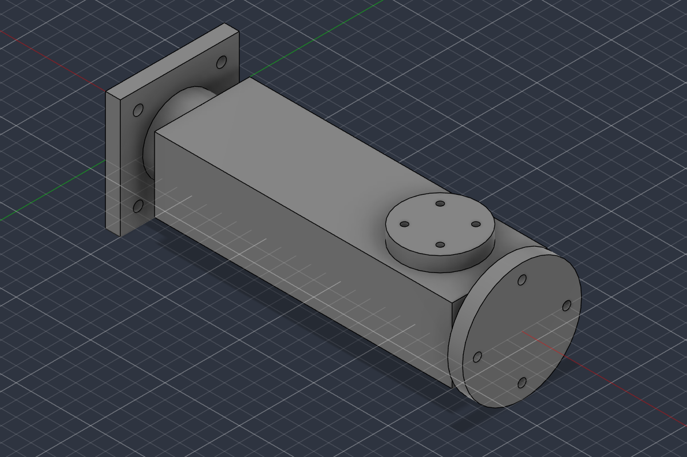

*Figure 1. Baseline arm before optimization: robot plate on the left, handling pad on top, rotary flange at the end.*

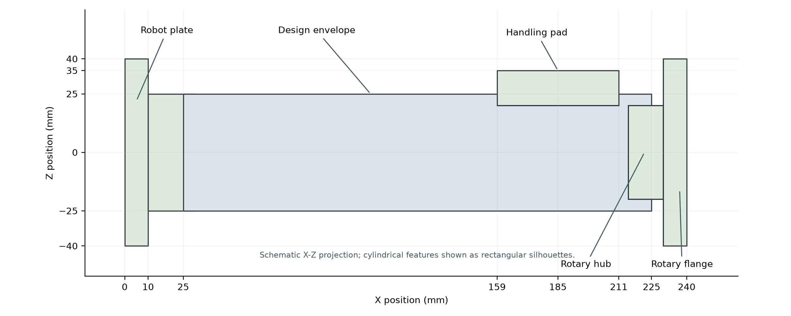

*Figure 2. Side view (X–Z) of the baseline features from the dimensions in Table 1. Cylinders are drawn as rectangles.*

**Table 2.** Load cases. Both use the same support: all translations fixed on the rear face at x = 0.

| Case | Applied load | Location | Expected root reaction |
|---|---|---|---|
| A, handling | F = (0, 0, −250) N | Pad top face, z = 35 | Fz = +250 N, My = −46.25 N·m |
| B, rotary | F = (−300, 0, 0) N and M = (+24, 0, 0) N·m | Flange end face, x = 240 | Fx = +300 N, Mx = −24 N·m |

The material is an isotropic linear elastic aluminium benchmark with E = 70 GPa, ν = 0.33 and ρ = 2700 kg/m³. No specific alloy, yield strength or fatigue limit was assigned. Placing the two tool faces apart gives each load its own path to the root, which is what lets a single-mode design drop the path it does not need.

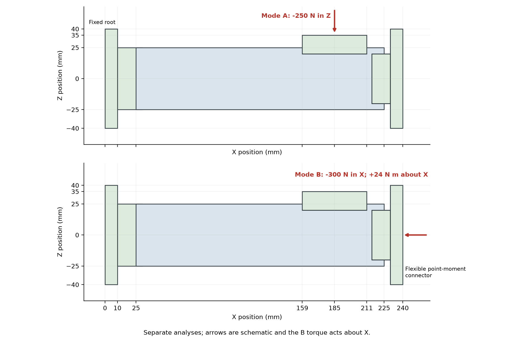

*Figure 3. The two load cases, applied in separate analyses. A: 250 N down on the pad. B: 300 N axial thrust and 24 N·m about X on the flange.*

The torque is applied with nTop's Point Moment block through a flexible connector, an RBE3-type element that spreads the moment over the flange face without stiffening it [3]. Four tangential bolt forces on the 60 mm pitch circle would have been closer to a real screwdriver mount, but the point moment is simpler to apply identically on every design. In all four case B analyses the torque does 93.7 % to 96.7 % of the work, so case B is effectively a torsion test with a small axial part.

Dividing each compliance by the baseline compliance under the same load removes the load magnitude, since compliance scales with the square of the load. The normalized results therefore do not depend on the 250 N, 300 N and 24 N·m values themselves, only on the ratio of thrust to torque inside case B.

## 3. Design space and material budget

The three interfaces were kept as solid preserved regions so that the optimizer could not remove material the tools and robot bolt to: P1 covers the plate and root boss, P2 the handling pad and a 10 mm land under it, and P3 the hub and flange. Each region was built from primitives and intersected with the baseline body, which keeps the bolt holes open.

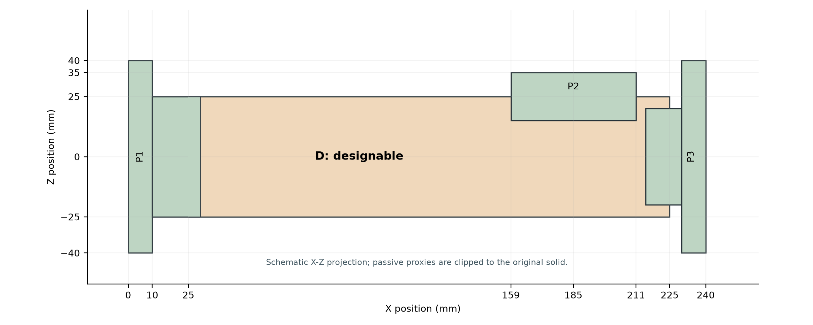

*Figure 4. Preserved regions P1 to P3 and the designable region D. P1 runs to x = 30 mm, the end of the root boss.*

**Table 3.** Volume accounting from nTop Mass Properties.

| Quantity | Volume (mm³) | Mass at 2700 kg/m³ (g) |
|---|---|---|
| Baseline body V0 | 808 438.0 | 2182.78 |
| Preserved regions VP | 211 905.9 | 572.15 |
| Designable region VD = V0 − VP | 596 532.1 | 1610.64 |
| Target: VP + 0.35 VD | 420 692.1 | 1135.87 |

The budget keeps 35 % of the designable volume while all preserved material stays. In nTop the volume response covers the whole body, preserved cells included, so the limit has to be given as a full-body fraction:

f = (VP + 0.35 VD) / V0 = 420 692.1 / 808 438.0 = 0.52038.

Measuring D on its own gives 596 404.4 mm³, 127.7 mm³ less than V0 − VP. The difference is 0.02 % of the body and its source was not found, so the subtraction value was used.

## 4. Baseline analysis

Before optimizing anything, the solid baseline was solved with linear tetrahedra at two mesh sizes. This gave the reference compliances, confirmed that both load cases produce the intended bending and torsion, and showed how sensitive the global response is to the mesh.

**Table 4.** Baseline mesh comparison.

| Quantity | 4.0 mm mesh | 2.5 mm mesh | Change |
|---|---|---|---|
| Nodes | 23 244 | 71 589 | |
| Compliance, case A (J) | 0.003907 | 0.003969 | +1.59 % |
| Compliance, case B (J) | 0.005034 | 0.005154 | +2.38 % |
| Maximum displacement A (mm) | 0.02234 | 0.02277 | +1.94 % |
| Maximum displacement B (mm) | 0.008295 | 0.008493 | +2.39 % |
| Peak von Mises A (MPa) | 3.251 | 3.860 | +18.7 % |
| Peak von Mises B (MPa) | 4.492 | 4.617 | +2.8 % |

Global stiffness moves by less than 2.5 % between the two meshes, which is enough for a pilot, and the 2.5 mm mesh (396 426 elements) was used for all three optimizations. Peak stress is a different matter: the case A peak rises 18.7 %. Both peaks sit on sharp corners, case A where the plate meets the root boss and case B at the step from hub to flange, where nodal stress keeps climbing with refinement. A two-mesh check on the baseline also says nothing about the much thinner members of the optimized designs.

The root reactions were exported for every node and summed. On the 2.5 mm baseline they match the applied loads within 0.0004 N and 0.0005 N·m. Appendix B lists the same check for all eight cases.

## 5. Optimization setup

The setup follows nTop's topology optimization workflow [4]: FE model, boundary conditions, a compliance response as objective and a volume fraction response as constraint.

**Table 5.** Settings shared by all three optimizations.

| Setting | Value |
|---|---|
| FE model | 2.5 mm linear tetrahedra, 71 589 nodes |
| Constraints | Preserved regions solid; volume fraction ≤ 0.52038 |
| Filter size | 8 mm |
| Maximum iterations | 100 |
| Minimum objective change | 0.0005 |
| Minimum density change | 0.01 |
| Boundary penalty | 0.5 |
| Iterations run (handling, rotary, dual) | 37, 38, 38 |

The handling-only run minimizes C_A and the rotary-only run minimizes C_B. The dual-mode run minimizes w_A·C_A + w_B·C_B, where C_A and C_B are two separate Structural Compliance Responses [5], each with its own boundary condition list. Putting both loads into one analysis would have been simpler to set up, but it adds cross terms between the two load cases and describes a part that is handling and screwdriving at the same moment, which never happens [2].

The runs stopped after 37, 38 and 38 iterations (Figure 11). At that point the largest design variable change was still about 0.13 in the handling run and 0.08 in the rotary run, above the 0.01 setting, and the solver's stopping reason was not recorded. The flat histories suggest the objectives had settled, but they are not proof of convergence. The rotary-only run was repeated once after the first attempt used a different filter size and save increment; all rotary results here come from the repeated run.

### 5.1 Choosing the dual-mode weights

The weights decide what "both functions" means, so they needed care. The two compliances have different sizes, and each grows with the square of its load. Adding them directly would let whichever happens to be larger drive the design, and doubling one load would quietly shift the balance. nTop does not normalize the weights in a multi-response objective and recommends bringing the responses to a similar order of magnitude [6]. Dividing each compliance by its solid-baseline value does that:

J = 0.5 · C_A / C_A0 + 0.5 · C_B / C_B0,   which means   w_A = 0.5 / C_A0 and w_B = 0.5 / C_B0.

The equal factor of 0.5 is a choice: it says both functions matter equally. A different split would give a different point on the trade-off between them.

**Table 6.** Dual-mode weights, as used and as checked afterwards.

| Basis | C_A ref (J) | C_B ref (J) | w_A | w_B | w_B / w_A |
|---|---|---|---|---|---|
| Iteration 1 of the single-mode runs (used) | 0.05145 | 0.06782 | 9.718 | 7.372 | 0.7586 |
| Solid baseline, external work (check) | 0.003969 | 0.005154 | 125.98 | 97.01 | 0.7701 |
| Solid baseline, case B without torque work | 0.003969 | 0.000183 | 125.98 | 2738.5 | 21.74 |

nTop's static analysis result gives displacement, strain, stress and reaction fields but no compliance or strain energy [7], so C_A0 and C_B0 were not available when the dual run was set up. The weights were taken instead from the first iteration of the two single-mode runs. Those values are not the solid-baseline compliances, but both runs start from the same density field, so their ratio was expected to be close to the right one.

After the final analyses, the baseline compliances were worked out from the exported displacements (Section 8). The first-iteration values turned out to be 12.96 and 13.16 times the baseline values, and the weight ratio used, 0.7586, is within 1.5 % of the 0.7701 that the baseline gives. Multiplying both weights by the same number does not move the optimum, so the relative emphasis was close to what was intended. This check compares weight ratios only; nTop's compliance response and the displacement-based estimate are not the same calculation.

The last row of Table 6 shows why the torque term matters. An earlier version of the estimate left it out. Without it C_B0 falls to 0.000183 J and the weight ratio jumps to 21.7, which would have made the rotary function about 29 times more important than intended. In the solid baseline the torque does 96.5 % of the case B work, so leaving it out does not give a rough answer, it gives a wrong one.

With the first-iteration weights, each term starts near 0.5 and the dual objective starts near 1.0 with no unit. The final comparison in Section 7 uses the same two-case normalization, but with the baseline estimates and the rebuilt solids, so it measures the intended trade-off rather than replaying the optimizer's own numbers.

## 6. Reconstruction and final meshes

Each density result was turned into a solid in the same way: Implicit Body from Topology Optimization at a density threshold of 0.5, Smoothen Body, union with the preserved regions, and intersection with the baseline body to cut off anything outside the original envelope. This is nTop's own post-processing route [4]. Their example blends the union with a 2 mm radius; here the radius was zero for all three designs, which keeps the interfaces exact but leaves sharp corners where the optimized and preserved material meet. The dual-mode smoothing used a 1 mm grid and 3 iterations. The final intersection mattered for mass: the handling arm dropped from 1149.61 g to 1143.26 g once the overhanging material was clipped.

**Table 7.** Reconstructed designs.

| Design | Volume (mm³) | Mass (g) | Above target | Mass saved vs baseline |
|---|---|---|---|---|
| Handling-only | 423 431.1 | 1143.26 | +0.65 % | 47.62 % |
| Rotary-only | 430 669.9 | 1162.81 | +2.37 % | 46.73 % |
| Dual-mode | 428 357.6 | 1156.57 | +1.82 % | 47.01 % |

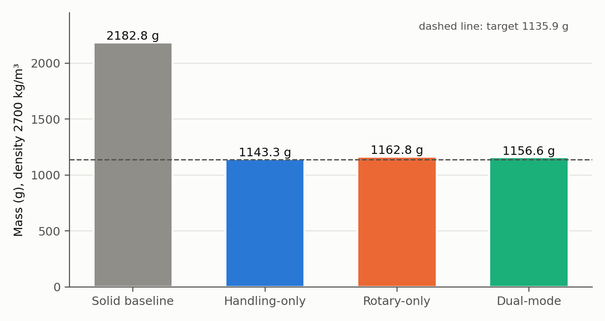

*Figure 5. Mass of the solid baseline and the three rebuilt designs at 2700 kg/m³. The dashed line is the 1135.9 g target.*

All three bodies end above the target, and by different amounts. Thresholding and smoothing added the most material to the rotary arm, 6.24 g more than the dual arm. The same volume constraint in the optimizer therefore did not give three equal-mass parts, and that matters for the closest comparison in Section 7.

Meshing the rebuilt bodies directly with FE Volume Mesh produced self-intersecting elements, and refining from 2.5 mm to 1.5 mm did not fix it, so those meshes were rejected. The working route was a surface mesh from the implicit body at 0.75 mm tolerance, remeshed to 2.5 mm triangles, filled with a robust tetrahedral mesh at 2.5 mm (regularity factor 10) and converted to a linear FE mesh. The final meshes have 52 635 (handling), 55 371 (rotary) and 55 073 (dual) nodes, with 267 810 tetrahedra in the dual mesh. None has intersecting elements, a split check finds one connected body in each, and maximum skewness is 0.970, 0.978 and 0.975. The worst elements are poor, with a minimum quality of 0.085 in the dual mesh. These checks show the meshes are usable, not that the results are mesh-converged.

Loads and supports had to be selected again on each new mesh, using thin 0.2 mm boxes on the root plane, pad top and flange face. The surface approximation pulls the flat faces in by 0.06 to 0.08 mm on average, so the boxes catch only part of each face: about 85 % of the root-face nodes, 77 to 78 % of the pad nodes and 84 % of the flange nodes. The applied totals are still exact, as the reactions show, and the coverage is nearly the same for all three designs.

## 7. Results

**Table 8a.** Displacement and compliance for the eight cases. Pad uz is the mean vertical displacement of the loaded pad nodes under A; flange ux and twist are taken over the loaded flange nodes under B. Compliance is estimated from external work (Section 8).

| Design | Pad uz A (mm) | Flange ux B (mm) | Twist B (°) | C_A (J) | C_B (J) |
|---|---:|---:|---:|---:|---:|
| Solid baseline | −0.01588 | −0.000609 | 0.01187 | 0.003969 | 0.005154 |
| Handling-only | −0.02165 | −0.05745 | 0.6107 | 0.005412 | 0.27303 |
| Rotary-only | −0.02573 | −0.000978 | 0.01961 | 0.006433 | 0.008507 |
| Dual-mode | −0.02392 | −0.001004 | 0.02126 | 0.005980 | 0.009205 |

**Table 8b.** Von Mises stress for the same cases. Peak is the highest nodal value, p99.9 the 99.9th percentile over all nodes.

| Design | Peak A / B (MPa) | p99.9 A / B (MPa) |
|---|---:|---:|
| Solid baseline | 3.86 / 4.62 | 3.05 / 3.52 |
| Handling-only | 4.26 / 485.4 | 3.35 / 162.3 |
| Rotary-only | 4.09 / 4.98 | 3.41 / 4.11 |
| Dual-mode | 4.61 / 4.92 | 3.39 / 3.98 |

The root reactions balance the applied loads in all eight cases. The force sums are within 0.001 N of 250 N and 300 N, the case B moment is −24.000 N·m for every design, and the case A moment lies between −46.215 and −46.250 N·m. The small spread in case A matches a pad load centre that sits up to 0.14 mm from x = 185 mm on the remeshed pads.

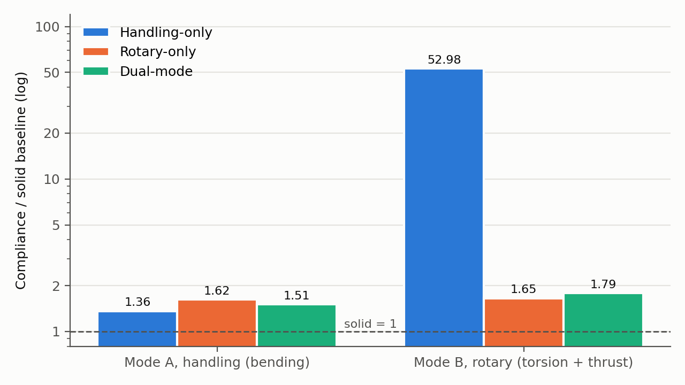

*Figure 6. Compliance of each design under each load case, divided by the solid baseline compliance for that case. Log scale.*

Under the rotary load the handling arm has no efficient load path. Its case B compliance is 53 times the baseline and 29.66 times the dual arm, and its flange twists 0.61° against 0.021°. The topology shows why (Figures 8 and 10): the bending-optimized layout narrows into a thin connection just ahead of the hub, and the case B stress peaks there at x = 213.4 mm. The rotary arm shows no matching weakness under handling. A reasonable explanation is that material placed around the arm axis to carry torsion also gives the section a useful bending stiffness, while the open, rib-like layout that suits bending gives very little torsional stiffness. The member cross-sections were not measured, so this remains an interpretation of the shapes and displacements.

The 485 MPa peak in the handling arm under case B comes from a linear elastic model at a sharp corner. Only 16 nodes exceed 300 MPa, and the 99.9th percentile is 162 MPa. For comparison, as-built LPBF AlSi10Mg has a coupon yield strength of about 250 MPa [8]. The peak is well above that, which marks the narrow section as a strength concern, but it does not predict yielding: the value is not mesh-converged, and no alloy or process was chosen for this arm. Every other case stays below 5 MPa, so at these loads the study compares stiffness, not strength.

**Table 9.** Normalized comparison, with C0 the solid baseline compliance for the same load case. Lower is stiffer.

| Design | Mass (g) | C_A / C_A0 | C_B / C_B0 | Mean score | Worst case |
|---|---|---|---|---|---|
| Handling-only | 1143.26 | 1.364 | 52.98 | 27.17 | 52.98 |
| Rotary-only | 1162.81 | 1.621 | 1.651 | 1.636 | 1.651 |
| Dual-mode | 1156.57 | 1.507 | 1.786 | 1.646 | 1.786 |

Compared with the specialists, the dual arm has 10.49 % higher compliance than handling-only under A and 8.21 % higher than rotary-only under B. Since the three masses are not equal, these are differences between the parts as built, not clean penalties for adding a second objective.

Rotary-only and dual-mode cannot be separated on the mean score. The rotary arm comes out 0.65 % better, but it is also 6.24 g (0.54 %) heavier. As a rough sensitivity check, scaling compliance with mass as C ∝ m^−k moves the two scores together, and they swap order at k = 1.20 (Figure 7). The exponent is assumed, not fitted, and no mass-matched models were solved, so the plot only shows that the mass difference is large enough to matter.

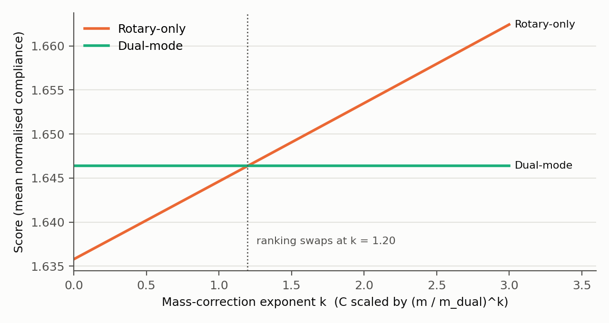

*Figure 7. Mean score of the rotary-only and dual-mode designs when compliance is scaled to the dual mass by (m / m_dual)^k, for an assumed exponent k.*

Two more numbers point the same way. On the worst of the two normalized compliances, the rotary arm is ahead (1.651 against 1.786), although worst-case performance was not what the dual run optimized. Scored with the dual run's own weights, the rotary arm is also 0.59 % lower (0.12524 against 0.12598). The optimizer worked on a density field, though, while this comparison uses rebuilt solids of different mass on different meshes, so neither number shows that the dual optimization failed. With the data available, the gap cannot be split between mass, mesh, the compliance estimate and the optimizer stopping early.

| Handling-only | Rotary-only | Dual-mode |
|---|---|---|
| 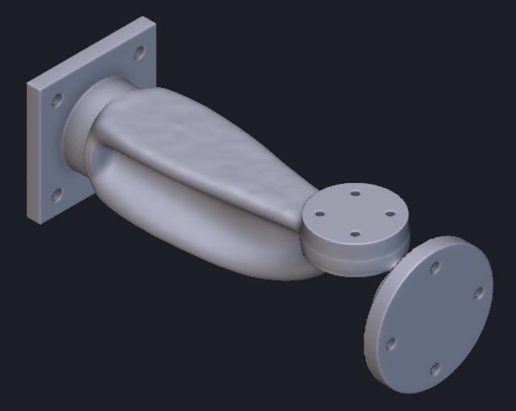 | 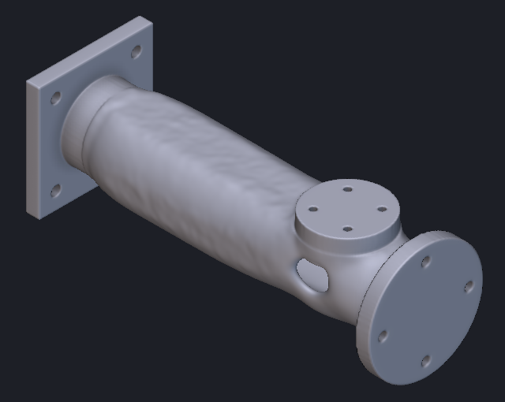 | 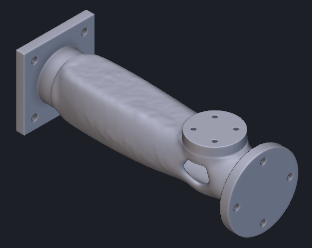 |

*Figure 8. The three rebuilt designs, same view and scale.*

| Handling-only, case B | Dual-mode, case B |
|---|---|
| 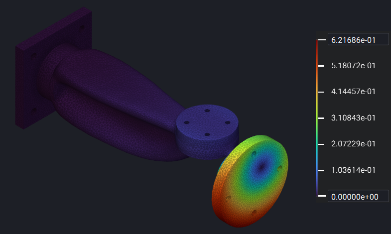 | 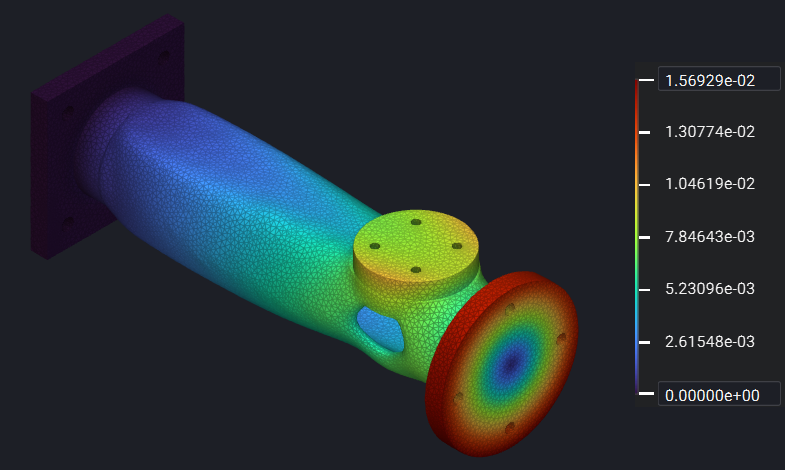 |

*Figure 9. Total displacement under the rotary load, in mm. The colour scales differ: 0.622 mm for handling-only, 0.0157 mm for dual-mode. The handling view is drawn at true scale and the dual view undeformed.*

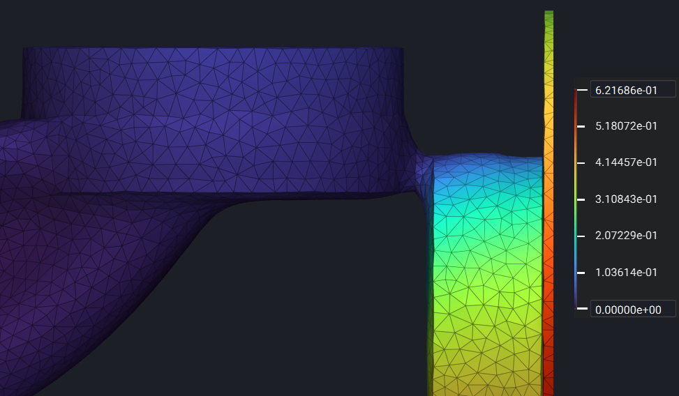

*Figure 10. Handling-only arm under the rotary load, front view between the arm body and the hub. The displacement changes sharply across the narrow connection, which is where the arm twists.*

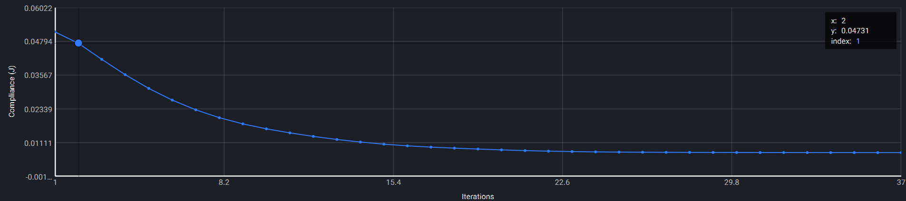

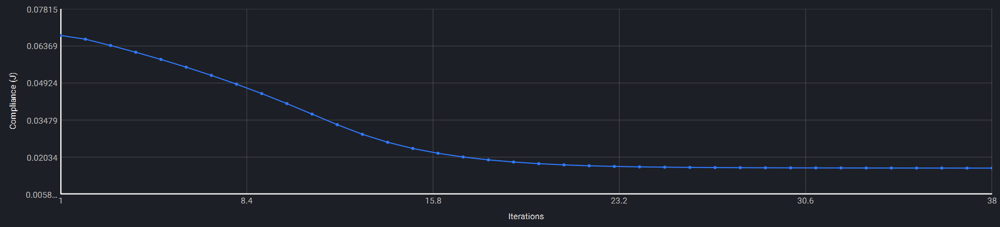

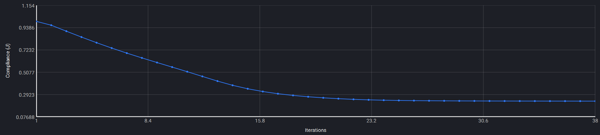

*Figure 11. Objective history of the handling-only, rotary-only and dual-mode runs, top to bottom. The first two show compliance in J. The dual plot shows the weighted sum, which has no unit even though nTop labels the axis in J.*

## 8. How the data was evaluated

Displacement, von Mises stress and reaction force were exported from nTop for every node as CSV files without headers: coordinates in mm, displacements in m, stress in Pa and reactions in N. `scripts/analyze_tooling.py` reads them and calculates:

- the summed root reactions and their moments about the origin, as an equilibrium check;
- the mean vertical displacement of the pad face and the mean axial displacement of the flange face;
- the flange twist, as the least-squares rigid rotation about X of the flange nodes after removing their mean translation;
- the compliance estimate, C_A = 250 · (−pad uz) and C_B = 300 · (−flange ux) + 24 · θ, with displacements in m and θ in rad.

Pad nodes are those within 0.1 mm of z = 35 and inside a 26.5 mm radius around (185, 0); flange nodes are those within 0.1 mm of x = 240 and inside a 40.5 mm radius. This band matches the 0.2 mm boxes used to apply the loads, so the measured motion belongs to the loaded nodes. Widening it to ±0.3 or ±0.5 mm keeps the rotary-versus-dual gap between 0.56 % and 0.65 %. The twist fit is tight: the RMS of the in-plane residual is 0.00014 to 0.00018 mm, against a rigid tangential displacement of 0.006 to 0.32 mm at 30 mm radius.

The exact discrete compliance would be fᵀu over all loaded nodes, with the torque multiplied by the connector's own rotation. The mean displacements and the fitted twist approximate that, which is why the values in Tables 8a and 9 are called estimates. nTop's Structural Compliance Response would give the exact value, but it was not run on the eight final models. Masses come from nTop Mass Properties.

Running `analyze_tooling.py` again on the raw exports reproduces both result tables exactly. `scripts/plot_results.py` draws Figures 5 to 7. Both scripts were run with Python 3.10, NumPy 2.2.6 and Matplotlib 3.10.9. The raw exports (about 110 MB) and the nTop notebook (about 1 GB) are too large for the repository and are available on request.

## 9. Software and references used

**Table 10.** Software and sources.

| Resource | Used for |
|---|---|
| Autodesk Fusion | Parametric baseline model with named parameters; STEP export |
| nTop 6.0.3 | Preserved regions, FE meshing, static analysis, topology optimization, reconstruction, mass properties, result export |
| Python 3.10, NumPy, Matplotlib | Evaluation of the exports and the charts in Figures 5 to 7 |
| nTop documentation [3]–[7] | Point Moment and its RBE3 connector, optimization and post-processing workflow, compliance response, weighting several responses, static result outputs |
| Bendsøe and Sigmund [2] | Compliance minimization with several load cases |
| Van Cauwenbergh et al. [8] | AlSi10Mg yield strength, used only for comparison with the stress peak |
| Automation.com case study [1] | A real two-tool robot adapter |
| My 2D SIMP playground | Getting a feel for penalization, filter radius and volume fraction before the 3D study; not used for any result here |

## 10. Uncertainty and limitations

**Table 11.** Sources of uncertainty, ordered by their effect on the rotary-versus-dual comparison.

| Source | Size | Effect on the ranking |
|---|---|---|
| Unequal rebuilt mass | Up to 1.7 % between designs | Can swap the order (k = 1.20) |
| Linear tetrahedra at 2.5 mm on thin members | Not measured | Unknown, affects every design |
| Optimizer stopped above the density-change setting | Not measured | Unknown |
| Weight ratio, used vs baseline | 1.5 % | Small |
| Node selection band | Gap 0.56 % to 0.65 % | No swap |
| Partial face coverage on final meshes | 77 % to 85 % of nodes | Same for all three designs |

How large the discretization error is on the final bodies, and in which direction, has not been measured. Element order, the 2.5 mm size, the poor worst elements and the 0.75 mm surface approximation can all affect thin connections differently from the solid baseline.

The model is linear static with an isotropic material, a fully fixed rear face and no bolts, contact or preload. The loads are benchmark values rather than data from a real robot or tool. No yield, fatigue, buckling or AM process check was made, and no part was printed or tested.

## 11. Conclusions

The clearest result is the asymmetry between the two specialists. Optimized for bending alone, the handling arm is stiff under its own load but very flexible in torsion, because its layout narrows into a thin connection ahead of the hub. Optimized for torsion, the rotary arm stays reasonably stiff in bending too. The dual-mode arm improves the handling response compared with rotary-only and gives up some rotary stiffness in return.

Between rotary-only and dual-mode the numbers are too close to call at unequal mass and without a mesh study on the final bodies. That is a result in itself: for this part, the design driven by the torsion case already covers much of what the bending case needs, and the dual objective mainly trades between the two, with 7.0 % lower handling compliance than rotary-only for 8.2 % higher rotary compliance.

## 12. Next steps

For feedback on this pilot no new simulation is needed, as long as the close ranking stays open. To settle it, the rotary and dual designs should be compared at equal mass, using nTop's compliance response on the final bodies and a mesh refinement or quadratic elements on the thin connections. Recording each solver's stopping reason would close the remaining gap in the optimization record. Taking the arm towards production would first need a chosen AM process, real interface and load data, material allowables and a bolted-joint model.

## References

[1] S. A. Webster, "Case study: Robotics integrator discovers binder jet 3D printing for automotive end of arm tooling," *Automation.com*, Mar. 10, 2021. [Online]. Available: https://www.automation.com/article/case-study-robotics-integrator-binder-jet-3d-print

[2] M. P. Bendsøe and O. Sigmund, *Topology Optimization: Theory, Methods, and Applications*, 2nd ed. Berlin, Germany: Springer, 2003.

[3] nTop, "Point Moment," nTop Product Documentation. [Online]. Available: https://docs.ntop.com/Product-Documentation/ntop/block-documentation/blocks/design-analysis/loads/point-moment

[4] nTop, "How to run a topology optimization," nTop Support. [Online]. Available: https://support.ntop.com/hc/en-us/articles/360044051214-How-to-run-a-topology-optimization

[5] nTop, "Structural Compliance Response," nTop Product Documentation. [Online]. Available: https://docs.ntop.com/Product-Documentation/ntop/block-documentation/blocks/optimization/responses/structural-compliance-response

[6] nTop, "Can I use more than one objective in a Topology Optimization?," nTop Support. [Online]. Available: https://support.ntop.com/hc/en-us/articles/360048490094-Can-I-use-more-than-one-objective-in-a-Topology-Optimization

[7] nTop, "Static Structural Result," nTop Product Documentation. [Online]. Available: https://docs.ntop.com/Product-Documentation/ntop/block-documentation/types/static-structural-result

[8] P. Van Cauwenbergh *et al.*, "Unravelling the multi-scale structure–property relationship of laser powder bed fusion processed and heat-treated AlSi10Mg," *Sci. Rep.*, vol. 11, Art. no. 6423, 2021, doi: 10.1038/s41598-021-85047-2.

## Appendix A: Model and solver settings

| Item | Value |
|---|---|
| CAD | Fusion, parametric v02; exported as STEP AP214 |
| Software | nTop 6.0.3 |
| Material | E = 70 GPa, ν = 0.33, ρ = 2700 kg/m³ |
| Optimization mesh | 2.5 mm linear tetrahedra; 396 426 elements; 71 589 nodes |
| Optimization settings | Filter 8 mm; 100 iterations max; minimum objective change 0.0005; minimum density change 0.01; boundary penalty 0.5; save increment 5 |
| Dual weights | w_A = 9.718173, w_B = 7.372457 |
| Reconstruction | Threshold 0.5; Smoothen Body (dual: 1 mm grid, 3 iterations); zero-radius union with P1 to P3; intersection with baseline |
| Final meshing | Surface tolerance 0.75 mm; surface and tetrahedral target 2.5 mm; regularity 10; linear elements |
| Final mesh nodes | Handling 52 635; rotary 55 371; dual 55 073 |

## Appendix B: Reaction check for all eight cases

Root reactions summed over all restrained nodes; moments about the origin with coordinates in metres.

| Design / case | Nodes | Max displacement (mm) | Main reaction | Other root moments (N·m) |
|---|---:|---:|---|---|
| Baseline A | 71 589 | 0.022772 | Fz +249.99961 N; My −46.24955 N·m | Mx −0.00015; Mz −0.00025 |
| Baseline B | 71 589 | 0.008493 | Fx +300.00000 N; Mx −24.00000 N·m | My +0.00015; Mz −0.00001 |
| Handling A | 52 635 | 0.033608 | Fz +250.00004 N; My −46.21544 N·m | Mx +0.00311; Mz ~0 |
| Handling B | 52 635 | 0.621686 | Fx +300.00091 N; Mx −23.99997 N·m | My −0.01465; Mz −0.05555 |
| Rotary A | 55 371 | 0.037387 | Fz +250.00001 N; My −46.21609 N·m | Mx −0.01145; Mz ~0 |
| Rotary B | 55 371 | 0.014273 | Fx +300.00001 N; Mx −24.00000 N·m | My +0.05965; Mz +0.00600 |
| Dual A | 55 073 | 0.034505 | Fz +250.00007 N; My −46.22603 N·m | Mx +0.05962; Mz +0.00018 |
| Dual B | 55 073 | 0.015693 | Fx +299.99997 N; Mx −24.00000 N·m | My −0.01644; Mz +0.00582 |
